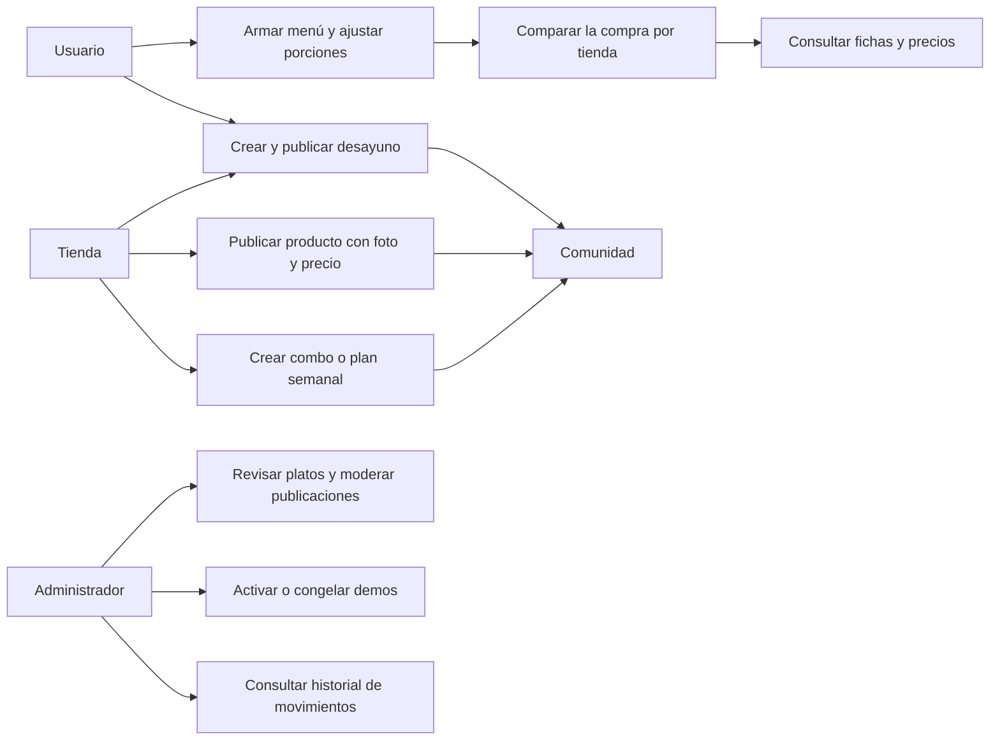
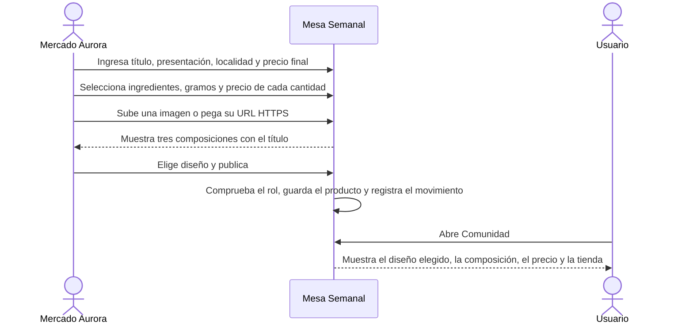

# Qué hace cada cuenta en Mesa Semanal

El punto de partida es el mismo para todos: un desayuno tiene ingredientes y cantidades. Lo que cambia es qué quiere hacer cada persona con esa información.

## Un producto, desde la tienda hasta la comunidad

| Cuenta | Ejemplo de uso | Restricción |
|---|---|---|
| Usuario | Armo mi semana, marco lo que desayuné y reviso cuánto me cuesta comprar los ingredientes. También puedo compartir una receta. | Para publicar necesito iniciar sesión. Mi ingrediente privado queda disponible en mis recetas. El lector puede ver la composición del desayuno publicado. |
| Tienda | Publico mi mezcla de avena y cacao. Pongo el precio correspondiente a los gramos de cada ingrediente y decido el precio final del envase. Puedo añadir desayunos del catálogo a mi recetario y armar planes semanales. | Los combos usan productos propios. Los planes usan platos propios publicados. Retirar un plato incluido en un plan requiere resolver esa referencia. |
| Administrador | Busco una cuenta, reviso sus publicaciones, corrijo el título o la preparación de un plato de tienda y consulto el historial. | El servidor valida el rol. Un plato usado en un plan puede ocultarse. El estado de suscripción demo es independiente de la suspensión de la cuenta. |

## Qué significa activar una demo

Una cuenta empieza sin demo. Administración puede activarla, congelarla y reactivarla. El historial guarda quién hizo el cambio y cuándo. Esta versión gestiona estados de demostración, sin pasarela de cobro. El historial conserva los últimos 300 movimientos registrados. Las publicaciones anteriores a la incorporación de estos eventos mantienen sus datos originales.

## Cómo probarlo

1. En **Mi tienda → Mis productos**, añade un ingrediente con **＋**, indica sus gramos y su precio, escoge una foto y compara los tres diseños.
2. Publica y abre **Comunidad → Productos publicados por tiendas**. Revisa el nombre público de la tienda, la imagen y el precio por presentación.
3. En **Catálogo de platos**, añade una receta. Abre **Mis desayunos** para verla con una imagen de referencia.
4. Con una cuenta administradora, abre **Platos de tiendas** y guarda un cambio en la preparación. Revisa **Historial de movimientos**. Activa o congela una demo desde **Suscripciones demo**.
