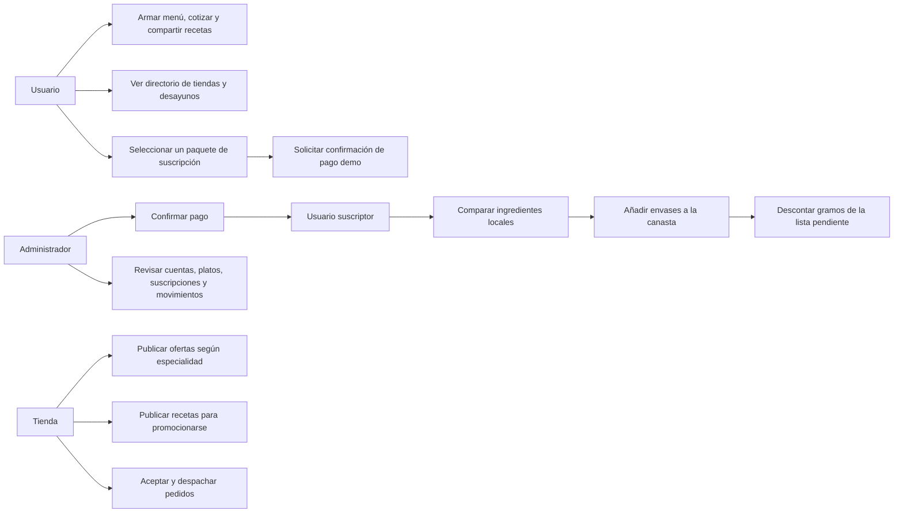
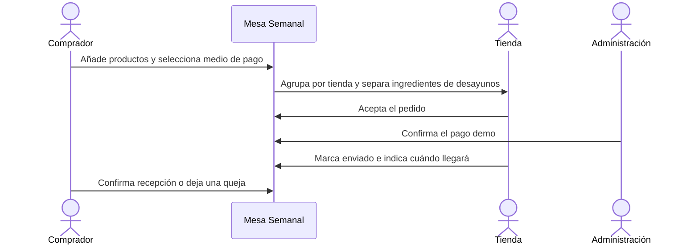

# Mesa Semanal · quién hace qué

La compra empieza con una pregunta concreta: «Ya escogí mis desayunos, ¿qué ingredientes me faltan y dónde me conviene comprarlos?». Hay cuatro experiencias y tres roles de cuenta. Suscriptor es un usuario con acceso a la comparación conjunta de ofertas locales mientras su suscripción esté vigente.

| Vista | Qué puede hacer | Regla importante |
|---|---|---|
| Usuario | Entrar a cada tienda, revisar y comprar sus ingredientes o desayunos, crear recetas y menús y registrar una solicitud de suscripción. | El pago demo requiere confirmación de administración. El sistema asigna un identificador al pedido. |
| Suscriptor | Además puede comparar precios locales de ingredientes y añadir envases completos. | El precio reducido compara soles por gramo contra al menos una de las cuatro cadenas con precio referencial. La pantalla indica cuál. |
| Tienda | Escoge ingredientes, desayunos o ambos. Publica la foto, el peso del envase y el precio final. Todas las tiendas pueden crear recetas promocionales gratuitas. | Una tienda de desayunos usa ingredientes existentes. El panel permite partir de una plantilla con preparación y composición calculada. Una tienda de ingredientes etiqueta la oferta con el alimento del catálogo. |
| Administrador | Confirma pagos, modera platos y cuentas, activa o congela demos y revisa pedidos y movimientos. | Congelar una suscripción restringe nuevas compras premium. Un pedido previo conserva su precio y su historial de estado. |

## Ejemplo de cantidades y pedidos

Si necesito 500 g de fresa y añado una bandeja local de 100 g, quedan 400 g por cotizar antes de descontar la despensa. El importe local depende del precio de la bandeja. El de supermercado depende de cuántos envases completos necesito. La reserva sigue contando mientras el pedido esté pendiente o en envío. Al confirmar recepción o registrar una queja deja de considerarse compra pendiente.

## Suscripción y pagos

Paquetes de demostración de 1, 3 y 12 meses. La confirmación manual activa el acceso durante el plazo elegido. El carrito admite Yape, Plin y transferencia como medios declarados. No hay débito, apertura verificada de una billetera ni conciliación bancaria automática. La estimación de entrega la introduce el comercio. Los pedidos son una demostración local, sin operador logístico.

## Qué tomar de Yapa

En la copia revisada, `src/components/FaqChatbot.tsx` llama a `searchFaq` de `src/utils/faqSearch.ts`. El buscador usa temas, palabras normalizadas, sinónimos y preguntas precargadas. La respuesta seleccionada se añade al historial. La función separada de canasta con IA tiene un cliente de modelos en `api/src/yapa_sdd/ia.py`.

En Mesa Semanal empezaría con preguntas sobre porciones, precios referenciales, reservas y recepción. Después añadiría búsqueda por tema y sinónimos, y evaluaría qué consultas quedan sin respuesta. Una fase posterior podría consultar un modelo desde el servidor con fragmentos de esas reglas, sin compartir credenciales ni datos de otros pedidos.
